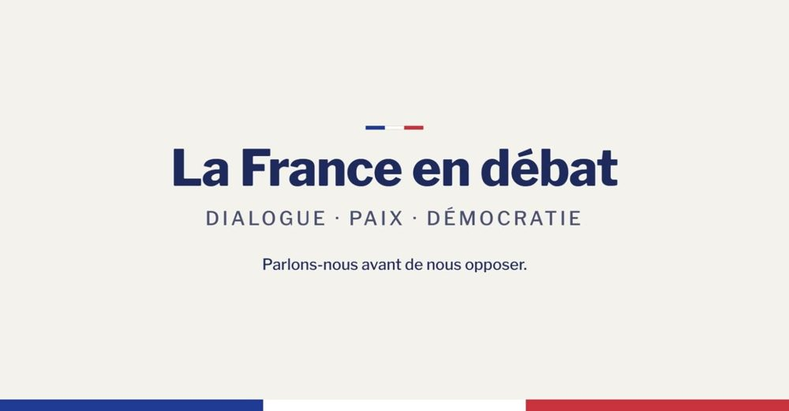

# La France en Débat

[Français](README.md) | **English**



[Live site](https://lafranceendebat.fr) · [Source code (AGPL-3.0)](https://github.com/belbeche/lafranceendebat) · [Good first issues](https://github.com/belbeche/lafranceendebat/labels/good%20first%20issue)

An open-source civic platform for **peaceful, source-based public debate**: citizens debate, submit proposals, and follow official commitments, with strict moderation (no insults, threats or hate) and **public ranking algorithms**. Built with Symfony 6.4, PHP 8.2+ and Bootstrap 5. The interface and content are in French; the code and documentation are open to contributors from everywhere.

This repository is public so that anyone can **check how the platform works** (rankings, data collection, moderation) and **contribute**. Secrets, member data and production settings are not in this repository.

## Why this project

- **Transparent algorithms.** Every ranking and automatic calculation is documented with its exact parameters (currently in French: `docs-publics/ALGORITHMES.md`).
- **Respect for privacy.** No third-party trackers, no tracking pixels in e-mails, audience measured without cookies, read-time measured only with consent, strict retention periods.
- **Peaceful debate.** A moderation filter blocks insults, threats and hate before publication, and every blocked message is reviewed by humans. Opinions are never judged, only tone.
- **Official sources first.** A debate cannot open without at least one official source.

## Quick start (5 minutes)

```bash
git clone https://github.com/belbeche/lafranceendebat.git && cd lafranceendebat
composer install
cp .env.example .env.local        # then change APP_SECRET
php bin/console doctrine:database:create --if-not-exists
php bin/console doctrine:schema:update --force
symfony serve                      # or: php -S localhost:8000 -t public
```

By default: local SQLite database, no e-mail actually sent (`MAILER_DSN=null://null`), no payment (no Stripe key). **You do not need any external account to contribute.**

## Tests

```bash
APP_ENV=test php bin/console doctrine:schema:create
APP_ENV=test MAIL_FROM=no-reply@example.org php tests/e2e/e2e_moderation.php
```

Each `tests/e2e/e2e_*.php` file is a standalone scenario that prints `OK` or `KO` per check and exits with an error on any `KO`. Clear `var/cache/test` between runs.

## Understand the project

- [`docs-publics/ARCHITECTURE.md`](docs-publics/ARCHITECTURE.md): code map, rules that must never break, where to add what (French).
- [`docs-publics/CONVENTIONS_DE_CODE.md`](docs-publics/CONVENTIONS_DE_CODE.md): how to document, write and propose code (French).
- [`docs-publics/FONCTIONNALITES.md`](docs-publics/FONCTIONNALITES.md): what each feature does and where the code lives.
- [`docs-publics/ALGORITHMES.md`](docs-publics/ALGORITHMES.md): exact parameters of every ranking and calculation.
- [`docs-publics/DONNEES_PERSONNELLES.md`](docs-publics/DONNEES_PERSONNELLES.md): what is collected, why, and for how long.
- [`CONTRIBUTING.md`](CONTRIBUTING.md): how to propose a change.
- [`SECURITY.md`](SECURITY.md): how to report a vulnerability (please do not open a public issue).

Most documentation is in French today. Translating it is itself a good way to contribute: see the issue "Translate the algorithms document into English" in [`docs-publics/TICKETS_DEBUTANTS.md`](docs-publics/TICKETS_DEBUTANTS.md).

## How to contribute

Contributing is free and requires no contract. Your contributions stay under the same license as the project (AGPL-3.0). Beginner-friendly tasks are labeled [`good first issue`](https://github.com/belbeche/lafranceendebat/labels/good%20first%20issue). Please read the [code of conduct](CODE_OF_CONDUCT.md) first: we apply to code reviews the same respect we ask of debates.

Welcome contributions: bug fixes, accessibility, translations, tests, documentation, performance. Changes to ranking algorithms, personal data processing, moderation or payments need a discussion first (see `CONTRIBUTING.md`).

## License

**GNU AGPL v3.** Anyone can use, study and modify the code. Anyone who runs a modified version as an online service must publish their modifications under the same license. This is intentional for a civic platform: the code cannot be privatized. See `LICENSE`.

## Publisher

La France en Débat is published by Axis Humain, a French sole proprietorship (micro-entreprise). It is not an association and does not issue tax receipts. Contact and legal notices: see the live site.
